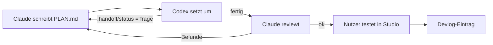

# Arbeitsablauf

| Rolle | Wer | Aufgabe |
|---|---|---|
| Planer/Reviewer | Claude | Architektur, [[PLAN]] schreiben, Review |
| Umsetzer | Codex | Schritte aus dem Plan umsetzen, Check laufen lassen |
| Tester | Nutzer | Spielt in Studio und auf dem Handy |

## Regeln
- Vor jedem Abschluss: `scripts/check.ps1` muss `OK` melden.
- Grüner Check ersetzt **nicht** den Test in Studio – Teststatus ehrlich angeben.
- Nach jedem Plan ein Eintrag in [[DEVLOG]].
- Commits auf Deutsch mit `feat:`, `fix:`, `docs:` …; Arbeit auf Feature-Branches.

Details: [[AGENTS]], [[CLAUDE]]
