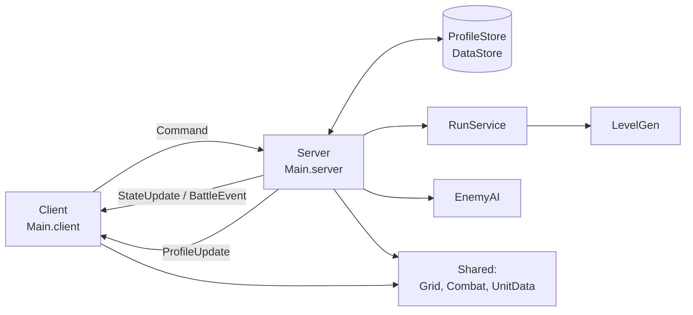

# Architektur

Projekt in **Luau**, synchronisiert mit **Rojo 7.7.1** (`default.project.json`) nach Roblox Studio.

| Ordner | Landet in Roblox | Inhalt |
|---|---|---|
| `src/shared/` | ReplicatedStorage.Shared | Daten & Formeln für beide Seiten → [[Shared-Module]] |
| `src/server/` | ServerScriptService.Server | Spielzustand, Prüfung, DataStore → [[Server-Module]] |
| `src/client/` | StarterPlayerScripts.Client | Eingabe, UI, Kamera, Animation → [[Client-Module]] |

## Grundregeln
- **Server ist autoritativ.** Der Client schickt nur Wünsche über `Remotes.Command`; der Server prüft Besitz, Reichweite, Phase und Kosten. Siehe [[Remotes und Befehle]].
- **Werte zentral** in `Config`, `UnitData`, `Stages`, `Recruit`, `RunConfig` – nicht in der Logik verstreut.
- **Shared = reine Daten/Formeln**, UI nur im Client, DataStore nur auf dem Server.
- Profiländerungen immer über `ProfileStore.normalize`, damit alte Profile weiterlaufen → [[Profil und Speichern]].

## Datenfluss

Verwandt: [[AGENTS]], [[Kampfsystem]], [[Roguelike-Läufe]]
